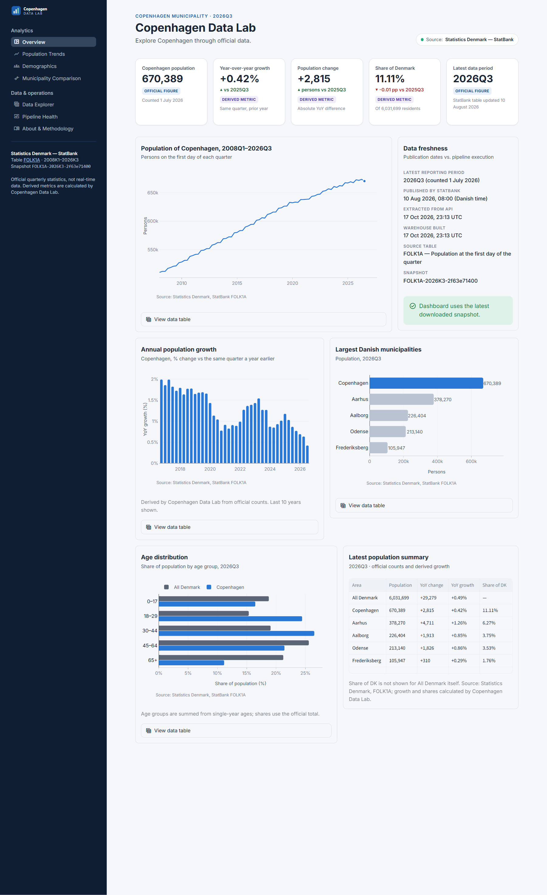
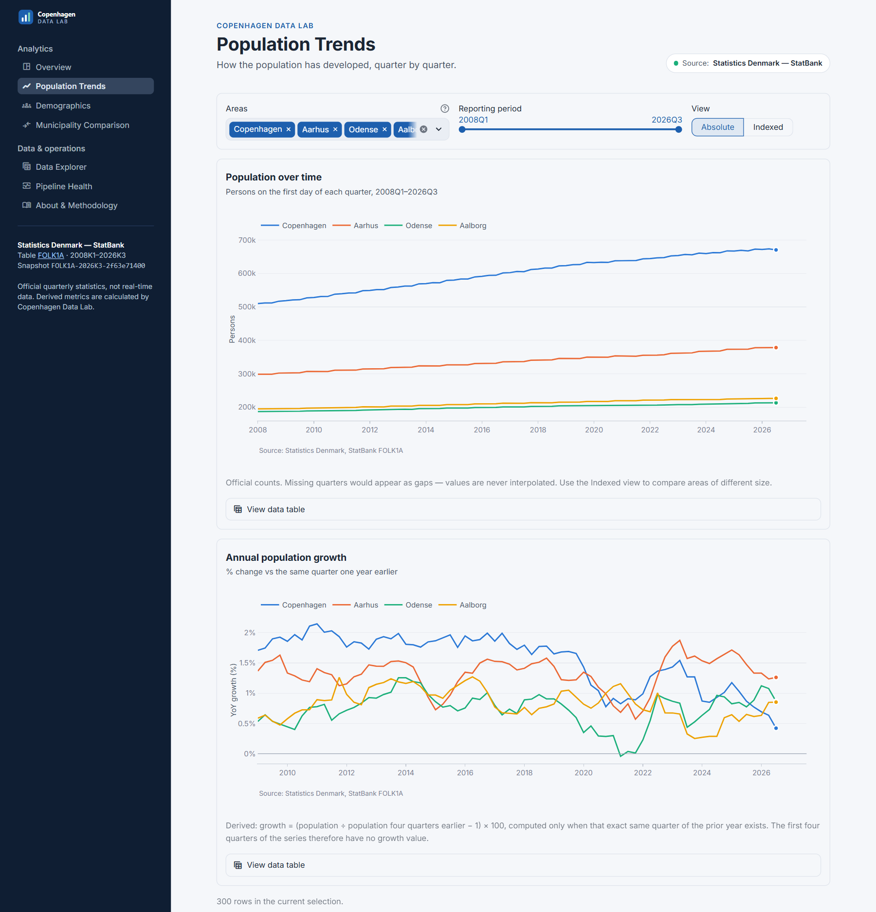
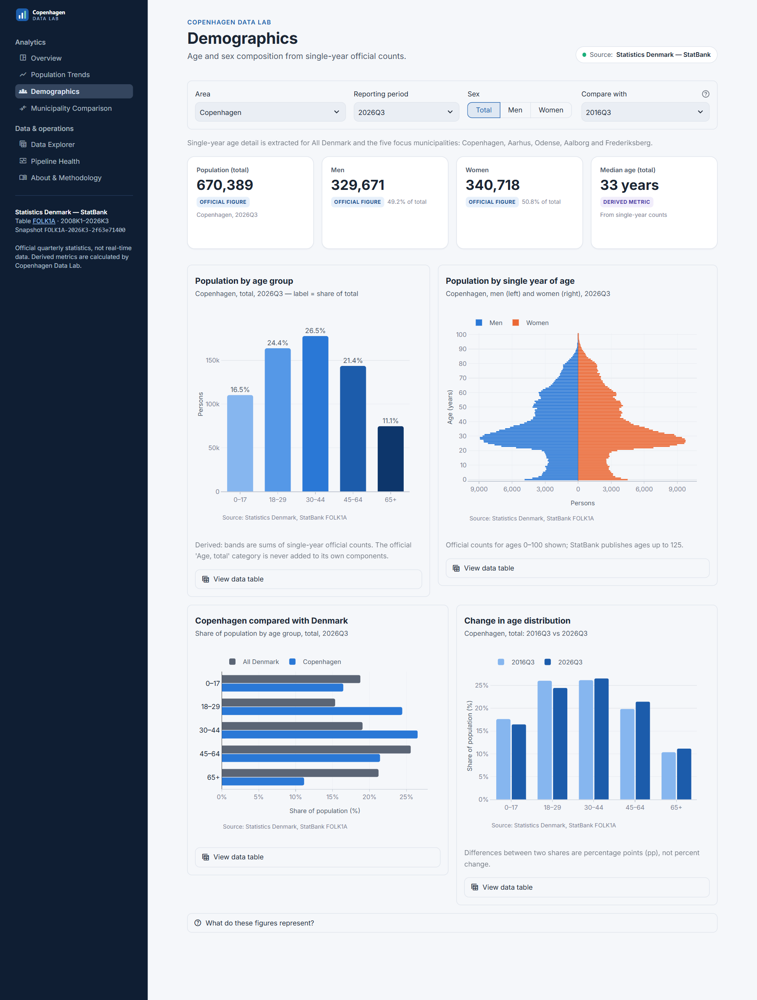
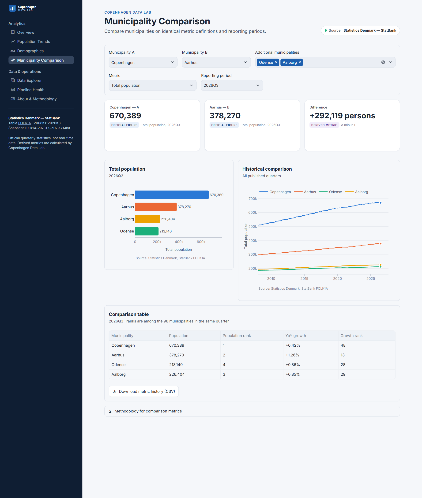
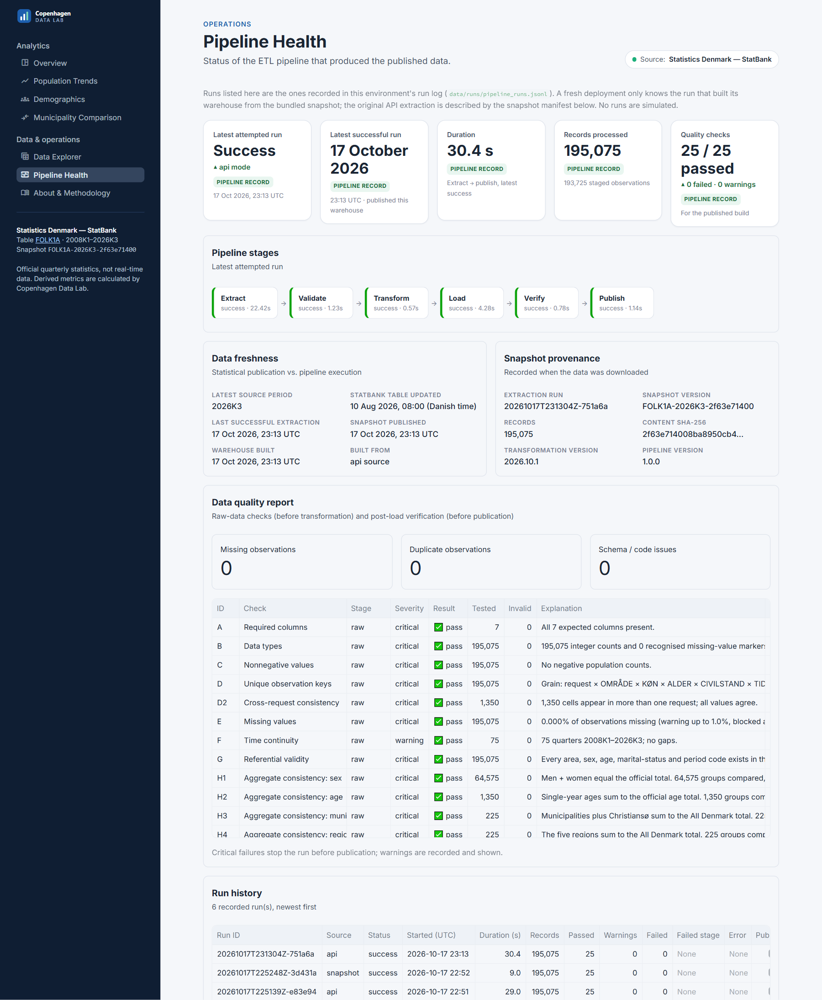
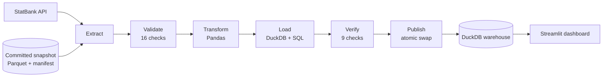

# Copenhagen Data Lab

**An end-to-end data platform that turns official Danish statistics into a trustworthy
analytics dashboard.**

`Python` · `SQL` · `DuckDB` · `Pandas` · `REST API` · `ETL` · `Data quality` · `Streamlit` ·
`Plotly` · `Pytest` · `GitHub Actions`



## In 30 seconds

- **Real official data.** The pipeline pulls population statistics from the Statistics
  Denmark StatBank API: 195,075 records covering 105 areas over 75 quarters (2008–2026).
  No numbers are invented.
- **A production-style pipeline.** It runs Extract → Validate → Transform → Load → Verify →
  Publish into a layered DuckDB warehouse. If anything fails, the last good data stays
  online.
- **25 automated quality checks** run before and after loading, including an independent
  recalculation of key metrics. All of them pass on the current data.
- **98 automated tests and CI.** CI never depends on the live API, and a monthly workflow
  proposes data refreshes as pull requests.
- **A 7-page interactive dashboard** for trends, demographics, municipality comparisons, a
  data explorer and pipeline health.

## What this project demonstrates

| Skill | What I built | Where to look |
|---|---|---|
| **API integration** | A typed StatBank client: JSON POST requests, timeouts, retries with exponential backoff, `Retry-After` handling, and clear errors | [`api/statbank_client.py`](src/copenhagen_data_lab/api/statbank_client.py) |
| **ETL pipeline design** | Six separate stages, two source modes (live API or offline snapshot) sharing the same code, and a log of every run | [`pipeline/`](src/copenhagen_data_lab/pipeline) |
| **SQL and data modelling** | Raw → staging → mart layers in DuckDB, with primary and foreign keys and `CHECK` constraints, window functions and documented table grains | [`sql/`](src/copenhagen_data_lab/sql) |
| **Data quality engineering** | 16 raw-data and 9 post-load checks. Any critical failure stops publication. | [`quality/checks.py`](src/copenhagen_data_lab/quality/checks.py), [`pipeline/verify.py`](src/copenhagen_data_lab/pipeline/verify.py) |
| **Pandas** | String-preserving parsing, nullable integers, explicit missing values, and an independent cross-check of the SQL results | [`pipeline/transform.py`](src/copenhagen_data_lab/pipeline/transform.py) |
| **Testing** | Unit, integration and end-to-end tests. They use a mocked API and a labelled synthetic fixture, and also render the dashboard pages. | [`tests/`](tests) |
| **CI/CD and automation** | A lint and test pipeline, plus a scheduled refresh that opens a pull request only when the data actually changed | [`.github/workflows/`](.github/workflows) |
| **Reproducibility and provenance** | A checksummed Parquet snapshot recording source, query parameters and versions. Two separate downloads gave byte-identical content. | [`pipeline/snapshot.py`](src/copenhagen_data_lab/pipeline/snapshot.py), [`data/snapshot/`](data/snapshot) |
| **Dashboard and data visualisation** | Streamlit and Plotly, with a colour-blind-checked palette, a data table under every chart, caching and parameterised SQL | [`dashboard/`](dashboard) |
| **Statistical correctness** | Exact same-quarter comparisons, no double-counted totals, missing values never filled with zero, derived figures clearly labelled | [`docs/methodology.md`](docs/methodology.md) |

## Engineering highlights

These are real problems I found while building against the live API.

**1. The API's streaming format silently drops zeros.** StatBank's `BULK` format leaves out
every cell whose value is zero. A real zero, such as "no 110-year-olds in Odense", would then
be indistinguishable from missing data. That affects 27,269 genuine zero cells in this
dataset. I switched to the `CSV` format, which returns the
complete cube, and added a check that every requested cell comes back exactly once.

**2. The request-size limit didn't match its own documentation.** `CSV` requests are capped at
1,000,000 cells. The server rejected a 171,450-cell request as "up to 1,028,700 cells", a
6× overestimate. Instead of guessing the server's formula, the extractor halves the time range
whenever the API says a request is too large.

**3. `LAG(population, 4)` is not "the same quarter last year".** `LAG` counts rows, not
quarters, so if one quarter is missing it silently compares against the wrong period. The SQL
joins on an exact quarter index instead. I removed 2020Q2 from Copenhagen's real data to
demonstrate the difference
([example query](src/copenhagen_data_lab/sql/examples/yoy_lag_vs_exact_join.sql)):

| Quarter | Naive `LAG(4)` | Exact quarter join |
|---|---|---|
| 2020Q4 | +1.824 % ❌ | +0.776 % ✅ |
| 2021Q2 | +1.002 % ❌ | not available (no comparable quarter) ✅ |

**4. Bad data never goes live.** Each build is written to a temporary database, verified, and
then swapped in with a single atomic file rename. The very first live run failed on the size
limit from point 2. The pipeline recorded the failure, exited with an error, and left the
published data untouched.

## Screenshots

| Population Trends | Demographics |
|---|---|
|  |  |
| **Municipality Comparison** | **Pipeline Health** |
|  |  |

## How it works



| Stage | What happens |
|---|---|
| **Extract** | Reads the table metadata first, finds area codes from their official names, then downloads two bounded data requests. The raw responses are archived unchanged. |
| **Validate** | Checks columns, data types, duplicates, missing values, unknown codes and time gaps, and verifies that totals add up (men + women, ages, municipalities, regions). |
| **Transform** | Converts types and keeps missing values explicit (never 0), builds dimension tables and age groups, and parses quarters into a sortable index. |
| **Load** | Builds a new DuckDB database with constrained staging tables and SQL marts. |
| **Verify** | Checks row counts, table grain and expected coverage, and recomputes growth and shares in Pandas to compare with the SQL. |
| **Publish** | Swaps the verified database into place atomically. Updates the snapshot only when the content checksum changed. |

The dashboard only reads the published database. It never calls the API, so visitors can't
trigger downloads and an API outage can't break the site. More detail:
[architecture](docs/architecture.md) · [methodology](docs/methodology.md) ·
[data dictionary](docs/data_dictionary.md).

## Run it yourself

Requires Python 3.11 or newer.

```bash
git clone https://github.com/mariusgreiersen/copenhagen-data-lab.git
cd copenhagen-data-lab
python -m venv .venv && source .venv/bin/activate   # Windows: .venv\Scripts\activate
pip install -r requirements.txt && pip install -e ".[dev]"

python -m copenhagen_data_lab.pipeline --source snapshot   # build from the bundled real data (offline, ~10 s)
streamlit run dashboard/app.py                             # open http://localhost:8501
```

To pull fresh data from Statistics Denmark, run
`python -m copenhagen_data_lab.pipeline --source api`.

## Tests and CI

```bash
pytest                                  # 97 offline tests: unit, integration, end-to-end, dashboard
CDL_LIVE_TESTS=1 pytest tests/live      # optional smoke test against the real API
ruff check . && ruff format --check .
```

- **Unit tests** cover the API client (retries, timeouts, malformed responses, schema
  changes), period parsing, metadata checks, and every quality check against the exact defect
  it should catch.
- **Integration tests** cover the SQL metrics against hand calculations. They also check
  failure behaviour: an API outage or bad data must leave the previous publication in place,
  and a tampered snapshot must be rejected.
- **End-to-end tests** rebuild from the real snapshot and re-derive the expected numbers from
  the raw records, and they render every dashboard page.
- **[CI](.github/workflows/ci.yml)** runs linting, all offline tests and the snapshot build
  on every push.
- **[Refresh](.github/workflows/refresh-data.yml)** runs monthly. It downloads, validates and
  re-checks the data, then opens a pull request only if the data changed. Merging the pull
  request publishes the new data.

## Project structure

```
src/copenhagen_data_lab/
  api/          StatBank client and metadata models
  pipeline/     extract · validate · transform · load · verify · publish · snapshot · run
  quality/      quality checks and the publication gate
  database/     read-only queries for the dashboard, column catalog
  sql/          staging tables, analytical marts, LAG-vs-join example
dashboard/      Streamlit app, pages and components
tests/          unit · integration · live (opt-in) · fixtures (synthetic, labelled)
data/snapshot/  committed real-data snapshot (~0.4 MB)
docs/           architecture, methodology, data dictionary, screenshots
```

## Deployment

The app is ready for Streamlit Community Cloud. Point it at `dashboard/app.py` and choose
Python 3.12; no secrets are needed. On first start it builds its database from the committed
snapshot in about 10 seconds, so it keeps working even if Statistics Denmark is down.
Step-by-step instructions, including the setting the refresh workflow needs, are in
[docs/deployment.md](docs/deployment.md).

## Limitations

- **One dataset so far.** FOLK1A (population) is the only table; employment, income and
  housing are not included yet.
- **Partial age detail.** Single-year ages are extracted only for Denmark and five focus
  municipalities, which keeps the snapshot small.
- **Quarterly, not real-time.** New data appears after a refresh pull request is merged.
- **Assumption about zeros.** Zeros are treated as genuine counts, which is a documented
  assumption based on FOLK1A being a full register count.

## Next steps

- More datasets: employment, income and housing.
- Maps with municipality boundaries.
- dbt models.
- Incremental loads.
- Alerts when new data is published.

## Licence and attribution

The code is [MIT-licensed](LICENSE).

The data comes from **Statistics Denmark** (StatBank table [FOLK1A](https://www.statbank.dk/FOLK1A)).
Statistics Denmark allows free reuse with source attribution, which they say corresponds to
[CC BY 4.0](https://www.dst.dk/en/presse/kildeangivelse). Growth rates, shares, indices, age
groups and ranks are my own calculations based on data from Statistics Denmark. This project
is not affiliated with Statistics Denmark.
