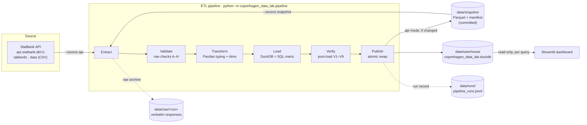

# Architecture

## Overview

The dashboard never talks to the API. The API is only called by the pipeline, either from a
developer's machine or from the scheduled GitHub Actions workflow.

## Stages

| Stage | Module | What it does | Failure behaviour |
|---|---|---|---|
| Extract | `pipeline/extract.py`, `api/statbank_client.py` | `tableinfo` → resolve codes from labels, verify totals and single-year ages → bounded `CSV` requests (split on `REQUEST-LIMIT`) → archive verbatim responses → `RawExtract` with string values. Snapshot mode reads Parquet after verifying SHA-256 checksums. | Transient errors retried with capped exponential backoff (honours `Retry-After`); other HTTP errors raise with the API error code. |
| Validate | `quality/checks.py` | 16 raw checks (A–H plus R0–R3, D2). | Any critical failure raises `QualityGateError`. |
| Transform | `pipeline/transform.py` | Typed staging frame (nullable `Int64`, `value_status`, original `raw_value`), de-duplication of overlapping cells, dimension tables from metadata, age groups. | Conflicting duplicates raise `TransformError`. |
| Load | `pipeline/load.py`, `sql/` | New DuckDB file under `data/build/`; raw table; constrained staging DDL (PK/FK/CHECK); SQL mart files executed in order; ops tables. | Constraint violations abort the load. |
| Verify | `pipeline/verify.py` | 9 post-load checks, including independent Pandas recomputation of YoY growth and shares. | Critical failure → run fails, build discarded. |
| Publish | `pipeline/publish.py`, `pipeline/snapshot.py` | API mode: write a new snapshot only if the content checksum changed (temp dir + swap). Write run history into the build, then `Path.replace` the build over the published warehouse. | Previous warehouse and snapshot remain untouched until the swap. |

Every run, successful or failed, is appended to `data/runs/pipeline_runs.jsonl` with stage
timings, check results and the error message.

## Layers in DuckDB

| Layer | Tables | Grain |
|---|---|---|
| Raw | `raw_population` | request × area × sex × age × marital status × quarter (strings) |
| Staging | `stg_population` | area × sex × age × marital status × quarter |
| | `dim_area`, `dim_sex`, `dim_age`, `dim_marital_status`, `dim_period` | one row per code |
| Mart | `mart_population_trends` | area × quarter |
| | `mart_population_demographics` | area × quarter × sex × age group |
| | `mart_municipality_comparison` | area × quarter (municipalities + country) |
| Ops | `quality_results`, `pipeline_runs`, `warehouse_info` | per check / run / build |

`dim_area` replaces the suggested `dim_municipality` because FOLK1A's area variable mixes four
levels (country, regions, municipalities, Christiansø); the `area_level` column keeps them
apart so totals are never mixed with their components.

## Publication strategy

**Local (single writer).** Builds go to `data/build/<run_id>.duckdb`. After verification
every connection is closed and the file is moved over the published path with an atomic
rename. Readers see either the old or the new complete database, never a partial one. The
dashboard opens a short-lived `read_only` connection per query, so no connection is shared
between sessions or held across a swap (on Windows the swap retries while a reader has the
file open).

**Deployed (Streamlit Community Cloud).** The container filesystem is ephemeral, so nothing
is written there that needs to survive. The only durable artefact is the committed snapshot in
`data/snapshot/` (~0.4 MB). On start, the dashboard builds its warehouse from that snapshot
with the same offline pipeline (`--source snapshot`, ~10 s) and caches it for the process.

**Refresh.** `.github/workflows/refresh-data.yml` runs monthly. It extracts from the API,
validates and verifies, rebuilds offline from the new snapshot, and, only if the content
checksum changed, opens a pull request with the new `data/snapshot/`. Merging that PR is the
publication step: the deployed app picks it up on its next restart/redeploy. New data
therefore becomes visible only after review and redeployment, never by writing to the
running app.

## Caching and invalidation

* `st.cache_resource` builds or locates the warehouse once per process, keyed on the
  snapshot's `content_sha256`. A new snapshot gives a new key, so a rebuild is triggered.
* `st.cache_data` caches query results keyed on the warehouse fingerprint (mtime + size).
  Publishing a new warehouse changes the fingerprint and invalidates every cached result.

## Why these choices

* **DuckDB.** An in-process columnar database with real SQL: window functions, constraints,
  `GROUP BY ALL`, and parameter binding. No server to run, a single file to publish, and fast
  enough that the full build takes seconds.
* **Pandas** for parsing and typing (nullable integers, string-preserving CSV parsing) and for
  the independent recomputation that cross-checks the SQL.
* **Separate raw / staging / marts.** Raw keeps exactly what the source said; staging adds
  types and constraints; marts encode analytical definitions. A wrong metric can be traced to
  the layer that introduced it.
* **Snapshots.** They give a reproducible, offline, checksummed input. CI, recruiters, and the
  deployed app all run the identical pipeline on identical bytes, and the API's availability
  never affects the dashboard.
* **Decoupled dashboard.** Anonymous visitors cannot trigger downloads, page loads are fast,
  and an API outage cannot break the site.
